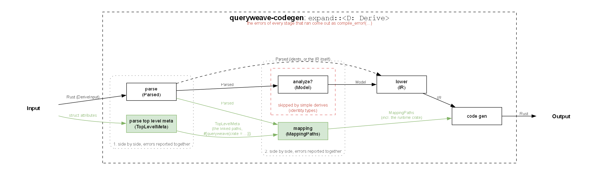

# Architecture

This document is for people working on queryweave itself: how the crates fit
together, how the generated code of one layer finds another layer's, how a
derive is built, and why the design looks the way it does. For using
queryweave, read the [guide](guide.md) instead.

## The crates

| Crate                           | Kind       | Role                                                                                                                                                              |
| ------------------------------- | ---------- | ----------------------------------------------------------------------------------------------------------------------------------------------------------------- |
| `queryweave`                    | library    | Core runtime: what the code generated for a domain model names. No database or serializer dependency.                                                             |
| `queryweave-api`                | library    | API runtime: `PageDto`, `SortDirectionDto`, one feature per integration (`serde`, `utoipa`, `schemars`).                                                          |
| `queryweave-sql`                | library    | SQL runtime: `Columns`, the clause writers, generic over the query (sqlx's, feature `sqlx`; sea-query's and SeaORM's, feature `sea-query`). No driver dependency. |
| `queryweave-codegen`            | library    | The code generation of every derive, as ordinary functions generic over the conventions.                                                                          |
| `queryweave-derive`             | proc-macro | The derives, each one line calling `queryweave-codegen` with the default conventions.                                                                             |
| `queryweave-custom-conventions` | proc-macro | Test fixture: the derives under other conventions and an integration of its own. Not published.                                                                   |

Two rules shape this split:

- **A proc-macro crate exports only derives.** Anything the generated code
  needs at runtime (traits, types) lives in a runtime crate, so both the macro
  and its user can name it. The code generation itself lives in a normal
  library, `queryweave-codegen`, so other proc-macro crates can reuse it with
  their own conventions.
- **Each layer depends on one runtime crate.** `queryweave-api` and
  `queryweave-sql` re-export the core (`pub use queryweave::*`), and each
  derive's generated code names exactly one runtime crate, the one of its
  layer. The domain only ever depends on `queryweave`, which keeps it free of
  sqlx and of any serializer.

## How the layers link

### Roots and mirrors

`Filters` is one derive with two roles, decided by whether the struct has
`#[filters(mirrors = path)]`:

- A **root** model owns its generated types (`UsersQueryModel`, ...) and
  hands its filters and sorting to the persistence layer as data.
- A **mirror** generates its own types (`UsersQueryParams`, ...) and converts
  them into the types of the struct it mirrors.

A mirror never rebuilds the mirrored struct's generated names from a naming
pattern; it reaches them through a trait on the path the user wrote:

```rust,ignore
pub trait Filterable {
    type Root: Filterable;
    type Query;
    type FilterOptions;
    type SortField;
    type SortDetails;

    fn query(page, page_size, sort, filters) -> Self::Query;
    fn into_root_query(query: Self::Query) -> <Self::Root as Filterable>::Query;
}
```

So `UserDto`'s code names `<UserModel as Filterable>::Query`, and each layer
can name its types under different conventions.

### Why role traits instead of `From`

The obvious conversion, `impl From<UsersQueryParams> for <UserModel as
Filterable>::Query`, does not compile: coherence cannot rule out that the
projection is `UsersQueryParams` itself, which would overlap the standard
`impl<T> From<T> for T`. So a mirror implements role traits instead
(`QueryOf<UserModel>`, `FilterOptionsOf<..>`, `SortFieldOf<..>`,
`SortDetailsOf<..>`), and the mirrored struct's own derive turns them into
`From` impls: `impl<T: QueryOf<UserModel>> From<T> for UsersQueryModel`.
Callers just write `.into()`.

### Chains

The mirrored struct can itself be a mirror, so a mirror publishes the same
things a root does: a `Filterable` impl (its query is its query parameters),
the blanket `From` impls, and `Filterable::query`, which builds a query from
its parts (a root's query and a mirror's query parameters are shaped
differently, so a struct literal would only fit one of them).

`Filterable::Root` is the model itself for a root, and the mirrored struct's
root for a mirror. It lets `IntoRootQuery` convert any query straight to the
root's, and it makes a cycle a compile error: two structs mirroring each
other cannot resolve their root (rustc reports `E0275`, at both `mirrors`
paths, since the generated projection is spanned to them). A struct naming
itself is caught earlier, by the macro.

`IntoRootQuery<M>` is generic over the mirrored struct rather than an
inherent method because its signature names that struct, which may be
private while the generated types are public.

### Merge patches

A patch field is an `Option<T>` (absent or a value) or a `Patch<T>` (absent,
`null` or a value). The derives never look at those types' names: they go
through traits.

- `PatchField<F>`: how a patch field applies to the model's field of type
  `F` (`Option<P>` replaces when `Some`; `Patch<P>` also clears an `Option`
  field on `Null`). `MergePatch::merge` calls it for each field.
- `PatchKind`: whether a field of that type may be `null` (`NULLABLE`) and
  whether this one is (`is_null`). `MergePatchNullableFields` builds
  `is_nullable(field)` from each field's `NULLABLE`; `ValidateNonNullable`
  calls `is_null`.

`Option<Option<T>>` is rejected by its shape (the derives may look at
`Option` shapes) in both `MergePatchNullableFields` and
`ValidateNonNullable`, with an error naming `Patch<T>`. Without that, it
would be accepted as an `Option<P>` and its `null` silently ignored. For the
same reason `MergePatch` requires its patch model to derive
`MergePatchNullableFields`, the derive that checks the patch's fields.

`Patch<T>` deserializes through the core's optional `serde` feature (turned
on by `queryweave-api`'s). It is documented per field with utoipa's
`#[schema(value_type = Option<T>)]`: utoipa composes generic field types
through a hidden trait, so implementing its public `ToSchema` is not enough.

`ValidateNonNullable` names no validation library by itself: it generates
`rejected_nulls()` and the `NullableFields` impl, and the one validation
integration flagged on it (`Integration::validate_non_nullable`, from the same
registry as the `Filters` flags) adds `validate_non_nullable()` in its
library's error type. Its mapping step rejects a flag that is no validation
library, and a second one. It names only core items, so its default runtime
is the core. `Patch<T>` gets validator's `range` rule and a schemars schema
from the core's optional `validator` and `schemars` features, both public
trait impls (unlike utoipa's, which needs a hidden trait).

`ValidateNonNullable` links the same way, through `NullableFields`:
`is_nullable(field)` under the struct's own names, and `Root`, the merge
patch model a chain ends at. Every `MergePatchNullableFields` model gets it
from a blanket impl; a `ValidateNonNullable` struct implements it by asking
the struct it mirrors under that struct's names. As with `Filters`, `Root`
turns a cycle into a compile error rather than infinite recursion at runtime.

### The persistence layer

The domain's generated types hand their data over as values tagged with the
model they describe (`Conditions<M>`, `SortKeys<M>`, `FieldValues<M>`), built
only by generated code. Domain field names become column names in exactly one
place, an entity deriving `Columns`. Its `push_conditions`, `push_order_by`
and `push_assignments` take the tagged data, so data cannot be paired with
another model's entity, and check when the code is built (after
monomorphization) that every field of the model has a column. They then hand
the data and the entity's columns to the query being built, through one
trait per clause it can take (`ConditionsTarget`, `OrderByTarget`,
`AssignmentsTarget`, `PageTarget`): the generated code names no query
builder, and the target decides how the clause is written. Two are
implemented. sqlx's `QueryBuilder` appends SQL text and binds the values.
sea-query's `SelectStatement`, `UpdateStatement` and `DeleteStatement` (which
SeaORM's queries hand out through `QueryTrait::query`) receive expressions
instead: the conditions as one `Condition` (`all` or `any`, by the
`Junction`) through `cond_where`, the sort keys through `order_by`, the page
through `limit` and `offset`, the assignments through `value`; sea-query then
renders them per database. Both backends write the same comparisons, binds
and `LIKE … ESCAPE '!'` patterns, from the helpers in `sql.rs`.

Each query builder is a backend module (`backend/sqlx.rs`,
`backend/sea_query.rs`) behind a Cargo feature of its name (`sqlx`, on by
default; `sea-query`), which only adds the target-trait impls, so unifying
features never changes generated code. The target traits name the features in
their `diagnostic::on_unimplemented` message, so a disabled backend is
reported as such rather than as a missing trait.

sea-query binds every value with its own type, whatever the column's, and
the database decides what a mismatch means (Postgres rejects it, MySQL and
SQLite convert it). SeaORM knows each column's type at run time
(`ColumnTrait::def`, a sea-query `ColumnType` and its nullability), so
`queryweave_sql::sea_query::check_column_types` compares those with a model's
value types (`PersistedFields::FIELD_TYPES`), once, from a test or at
startup. The caller hands the columns over: the generated code may name only
its runtime crate, and `queryweave-sql` depends on sea-query alone (SeaORM
needs a newer Rust than its MSRV). The check groups by meaning, not width,
since the database converts within a group (any integer in any integer
column), except a UTC date-time, which fits only a column with a time zone:
Postgres would convert one without by the session's time zone. A custom
column type is not checked.

Diesel is the third backend, and the odd one out. Its columns are types (one
per column, from `table!`) and its builders are consumed by value, so no
string can name a column and no `&mut` target trait fits. Diesel's own answer
to dynamic filters is a `match` from the name to the typed column, boxed
expressions (`BoxableExpression`) and boxed queries (`into_boxed`); for partial
updates, a changeset of `Option`s, `None` for the unchanged columns. The
`queryweave_sql::diesel` module (feature `diesel`) provides the typed half:
`condition`, `join`, `ordering`, `page` and `assignment` take a typed column
and an item of the model's data, and the `match` comes from the code generated
for the entity. The item's `Value` converts to the column's Rust type through
`ValueSqlType`, implemented per Diesel SQL type; the column's SQL type picks
the implementation (`Comparison`, `ColumnValue`), so the generated code is the
same call for every column and never classifies a type.

A domain field whose value does not fit its column (the domain and the schema
disagree on the type, or a field that may be `None` is written to a `NOT NULL`
column) fails to build, like a missing column: the domain derives publish each
field's value type next to its name (`PersistedFields::FIELD_TYPES`, from
`IntoValue::TYPE`, so the domain crate resolves value objects and private
fields itself), each `ValueSqlType` lists the `Value` variants it takes
(`ACCEPTS`, generated from the same list as the conversion, so the two cannot
drift), and `diesel_conditions` / `diesel_changeset` compare them in an inline
`const` block over the entity's columns (`FilterColumn::ACCEPTS` and
`AssignColumn::TYPE`, consts of the column bounds the methods already have, so
a column of an unsupported SQL type is still one error). Being post-monomorphization, it is reported by `cargo build`,
not `cargo check`: an item-level check would have to name the model's
generated types, which `Columns` cannot. Sort keys carry no value and are not
checked. What still does not fit at run time (a model implementing
`PersistedFields` by hand, which has no value types) is a `ValueMismatch`
error, never a panic. Each backend's own
date-time types come with `diesel-postgres`, `diesel-mysql` and
`diesel-sqlite`, which turn on Diesel's feature of the same backend, as
Diesel's ecosystem crates do.

`Columns` reads the column names from the ORM attributes of each library:
`#[sqlx(rename)]`, `#[sea_orm(column_name)]` or `#[diesel(column_name)]`
(which must agree when several are given), and leaves out `#[sqlx(skip)]`,
`#[sqlx(flatten)]`, `#[sea_orm(ignore)]`, `#[diesel(embed)]` and
`#[diesel(select_expression)]` fields, and `#[columns(skip)]` ones (a column
storing no domain field). It rejects `rename_all`, a renaming it does not
model.

An entity with `#[diesel(table_name = path)]` is a Diesel one: `Columns` also
generates `diesel_conditions`, `diesel_order_by` and `diesel_changeset`, each
a `match` from the domain field to the typed column `path::column`, calling
the `queryweave_sql::diesel` functions. Their `where` clauses state, per
column, that its SQL type converts (`FilterColumn`, `OrderColumn`,
`AssignColumn`), spanned to the column's field, so a column of an unsupported
SQL type is reported there; `#[columns(skip)]` takes it out.

That code names the runtime's `diesel` module, which exists only with its
`diesel` feature, and the derive cannot see the runtime's features (a `#[cfg]`
in its output would test the user's crate's). So the derive puts it inside
`queryweave_sql::__private::if_diesel!`, a passthrough the runtime defines
once per state of the feature: kept with it, dropped without it, before
anything is checked. An entity also used through sqlx costs nothing without
Diesel.

The wrappers know the entity, not its table, so they cannot name its columns.
`Columns` therefore also implements `queryweave_sql::diesel::Entity<'q, DB>`
for a Diesel entity, its table as an associated type and its conditions and
orderings as methods, under the same column bounds. Through it, an
`AppendConditions` wrapper gets `diesel_condition` (the set filters
as one condition, joined as asked), and an `AppendToQuery` wrapper gets
`diesel_apply_to` (a boxed query with the filters, sorting and page:
`diesel::apply`, which takes any `diesel::BoxedQuery`, a query whose `filter`,
`then_order_by`, `limit` and `offset` keep its type). Both are inside
`if_diesel!` too; a wrapper of an entity without `#[diesel(table_name)]` still
builds, and calling them reports that the entity is no `Entity`. No privileged
guard is needed: the caller adds it as a `filter` of the boxed query.

All SQL in `queryweave-sql` and the code generated for it is portable:
generic over the query (and, for sqlx, over `DB: BindValues`), standard SQL only (no `RETURNING`, `ILIKE`,
casts or quoted identifiers), every value bound, `LIKE` patterns escaped with
`!`. (sea-query quotes identifiers itself when it renders, so through it column
names match case-sensitively on Postgres.) Each SQL helper has a rendering test
per database for each backend, and runs against SQLite.

### Field types

The derives never decide what a field is by its type's name. They look only
at whether it is an `Option`, and leave the rest to the compiler through
traits: `RawValue` (the raw value a field filters on and binds), and the
filter kinds `Ordered` (`lt`, `gt`), `Text` (`sw`, `c`, `ew`) and `Boolean`
(`bool`), each with a `diagnostic::on_unimplemented` message. A new
filterable type is a new impl in `queryweave`, not a macro change.

## Integrations

A mirror's generated code names no third-party crate by itself. Every
library it can work with is an `Integration` (`queryweave_codegen::integrations`):
its flag, the integrations it requires, and its additions to each generated
type. `mirror.rs` merges the additions of the integrations a struct opts
into, in the order of the conventions' list (`BUILT_IN` by default).

Some decisions, and why:

- **Flags, not Cargo features of the derive crate.** Features unify across a
  build, so one layer's choice would leak into every other.
- **Runtime crate features add trait impls only.** `queryweave-api`'s
  `serde`, `utoipa` and `schemars` features derive traits on its types, which
  is additive and safe to unify.
- **No integration reads another's attributes.** Each states the wire format
  itself (snake case sort fields in `#[serde(..)]`, `#[schema(..)]` and
  `#[schemars(..)]` alike), and an unsortable mirror has no `sort` field
  rather than one each integration would have to skip.
- **A disabled feature is reported at the flag.** `queryweave-api` has a
  marker trait per feature (`features::Serde`, ...) with a
  `diagnostic::on_unimplemented` message, implemented only when the feature
  is on; an integration naming its types emits a check of it, spanned to the
  flag and emitted before the other items.
- **The mapping step checks the integrations together**: each one's
  requirements (`validator` needs `serde`), and that those providing a sort
  direction or page type agree on it.

## Inside a derive

Every derive is a pipeline of small steps, each a free function returning
`syn::Result`, unit-tested on its own:

| Step              | Module                  | Does                                                                                       |
| ----------------- | ----------------------- | ------------------------------------------------------------------------------------------ |
| struct attributes | `parse_top_level_meta/` | Reads the derive's own attribute (`#[filters(...)]`, ...) and `#[queryweave(crate = ..)]`. |
| parse             | `parse/`                | Reads the struct and its field attributes.                                                 |
| mapping           | `mapping/`              | Resolves what the generated code links to: other types, the runtime crate, a role.         |
| analyze           | `analyze/`              | Checks and models the fields.                                                              |
| lower             | `lower/`                | Turns the model into what code generation needs.                                           |
| code generation   | `code_gen/`             | Writes the code with `quote`.                                                              |

Each module has one file per derive. A derive with roles splits its last step
(`code_gen/filters/{root,mirror}.rs`). Simple derives skip steps with an
identity type (`()`, or the parsed input as the IR).

The order is not repeated per derive. Each derive implements the `steps::Derive`
trait in `pipeline/<derive>.rs`, whose associated types are its stages and
whose methods only delegate to the step modules, and `steps::expand` runs
them. Steps that do not depend on each other run side by side, and their
errors are reported together: struct attributes with parsing, then mapping
with analysis. Inside a step, several errors are collected with
`errors::Errors`.



Green marks the steps reading and resolving what a derive links to, red the
step simple derives skip. The dotted boxes are the stages `expand` runs side
by side.

The diagram is generated from [its Graphviz source](../assets/proc-macro.dot).
After changing the pipeline, update the source and regenerate it (requires
[Graphviz](https://graphviz.org)):

```shell
dot -Tpng -Gdpi=110 assets/proc-macro.dot -o assets/proc-macro.png
```

Struct attributes are read only through the option readers in `attributes`
(`path_option`, `required_path_option`, `flag_option`), which reject unknown,
repeated and malformed options. Every link to another type is an option of
the derive's own attribute, named after what it links to (`mirrors`, `patch`,
`model`, `columns`, `filters`).

### Where errors point

An error points at what the user wrote: a malformed attribute at the option,
a field problem at the field (or the name in its `#[equivalent_field]`), a
linked type at the path inside the attribute, the struct's own name at that
name. A name that must exist on another type (a mirror's field on the
mirrored struct, an entity's `#[domain_field]` on the model) is checked by
the generated code (`checks::assert_fields_exist`), so a stale name is a
compile error at the field, never a runtime mismatch. Generated code that is
not the user's keeps the call-site span, so lints treat it as generated.

Macro failures go through `errors` (a spanned message and a `help`), never
`panic!`.

### Paths in generated code

Generated code names the runtime crate only through the path its mapping step
resolved (and never sqlx: it is generic over the query's target traits):
`#[queryweave(crate = path)]`, or the conventions' `core_crate()`,
`api_crate()` or `sql_crate()` (absolute by default, so a local item cannot
shadow them). It never assumes what the user imported.

## Features

Every queryweave crate has a `merge-patch` feature, on by default, gating the
merge patch derives and their runtime (`Patch`, `PatchField`, `PatchKind`,
`ChangeSet`, `ChangedFields`, `MergePatchNullableFields`, `NullableFields`,
`push_assignments`). Unlike an integration, gating a derive is safe as a
Cargo feature: unification only ever adds derives, never changes what an
existing derive generates. `Columns` always emits `push_assignments` (and a
Diesel entity's `diesel_changeset`), inside
`queryweave_sql::__private::if_merge_patch!`, the same kind of passthrough as
`if_diesel!`: they name `queryweave-sql`'s merge-patch items, so what decides
is that crate's feature, not the derive's (a project may keep the derives'
default features and turn `queryweave-sql`'s off). `scripts/check.sh` checks
the crates build without it, and the gate's UI case without it.

`queryweave-sql`'s `sqlx` feature (default) is its sqlx backend (see the
persistence layer above); `scripts/check.sh` checks the crate with and
without it, including the UI case of its error.

## Versions

Every derive's output ends with a `const` calling
`require_version(MAJOR, MINOR)` in the runtime crate it names, with
`queryweave-codegen`'s own version. Before 1.0 the minor versions must be
equal; from 1.0 the majors must be, and the runtime's minor at least the
generator's. A mismatch fails the build with a message saying to use the
same version of every queryweave crate, instead of errors about missing
items. The check is emitted once, by `steps::expand`, for every derive.

## Conventions

Every naming rule, both the names a derive generates and the names it
requires, goes through `conventions::Conventions`, which every pipeline is
generic over; only a proc-macro crate picks one. Type names are local to a
layer; member names (filter fields, sort variants) are shared, since a mirror
names the mirrored struct's members with its own rules. See
[conventions.md](conventions.md).

A struct can rename some of its own generated types with options of
`#[filters(...)]` (`query`, `query_params`, `filter_options`, `sort_field`,
`sort_details`, `page`). The mapping step applies them over the conventions'
names, checks each renames a type of the struct's role, and that no two
generated types (or one and the struct) share a name; a clash between two
structs is beyond a derive's sight and stays rustc's duplicate definition.

## The public API of `queryweave-codegen`

Public: the derive functions, `conventions`, `integrations`, `errors` and
`names`, which is what a proc-macro crate with its own rules needs. Private:
`steps`, `attributes`, `checks`, `utils` and the step modules, free to
change.

## Testing

- Each pipeline step is unit-tested directly, with `insta` snapshots of
  generated code.
- `queryweave-derive/tests/<derive>.rs` test the behavior of the generated
  code.
- `trybuild` cases (`tests/ui/<derive>/{pass,fail}/`) check that valid code
  compiles and that every error path reports the expected diagnostic, at the
  expected place. Every new derive, attribute or error path gets a `fail`
  case.
- `queryweave-api/tests/ui/features` checks the feature checks both ways;
  `scripts/check.sh` builds `queryweave-api` alone under each feature
  combination, since a workspace build unifies them.
- `queryweave-sql/tests/sqlite.rs` runs the SQL against SQLite, in memory,
  and `tests/sea_query_sqlite.rs` the sea-query backend's, through
  `sea-query-sqlx`, and `tests/diesel_sqlite.rs` the Diesel backend's.
  `queryweave-derive/tests/sea_orm.rs` writes into real SeaORM entities'
  queries.
  `tests/postgres.rs` and `tests/mysql.rs` (MySQL and MariaDB) run it against
  real servers, which they start in containers, so they need Docker; the
  `fast` nextest profile leaves them out. `tests/diesel_postgres.rs` and
  `tests/diesel_mysql.rs` do the same for the Diesel backend, through
  `diesel-async` (Diesel's DSL over pure Rust drivers, so the tests need no
  libpq or mysqlclient); Postgres types parameters strictly, and MySQL and
  MariaDB must accept the bound `LIKE` escape character.
- `queryweave/tests/no_sqlx.rs` checks, with `cargo tree`, that no queryweave
  crate but `queryweave-sql` depends on sqlx, with all features and none: a
  domain using queryweave never gets sqlx from it.
- `queryweave-custom-conventions` checks that every rule of other conventions,
  and an integration of their own, reach the generated code.
